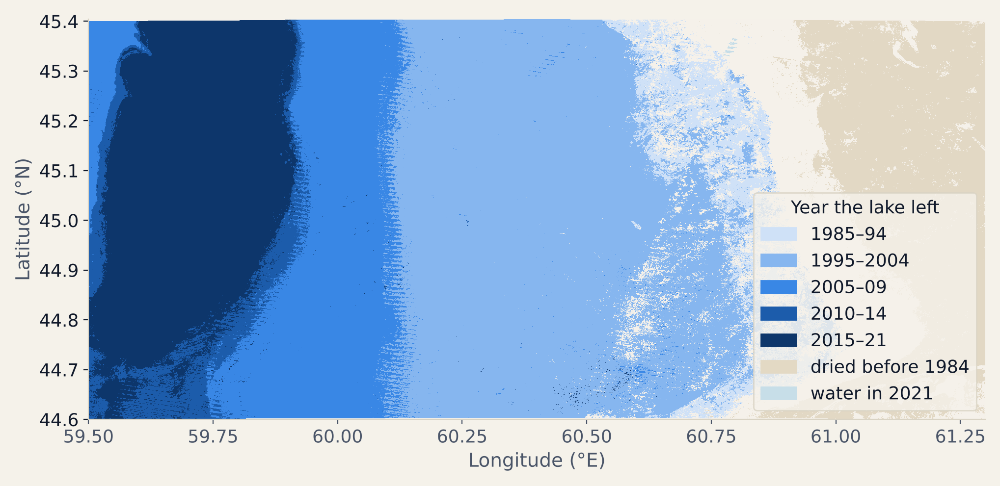
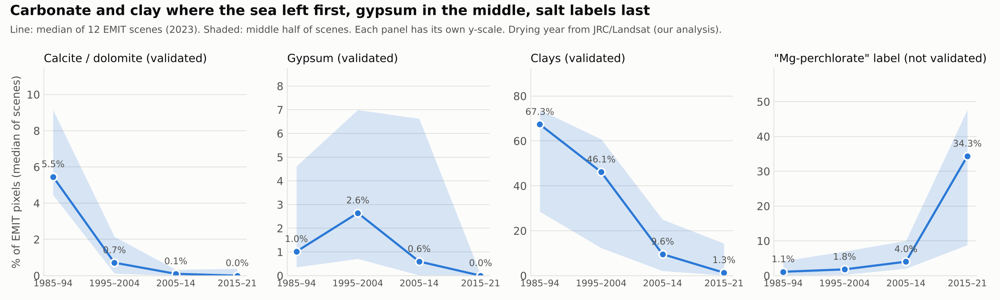
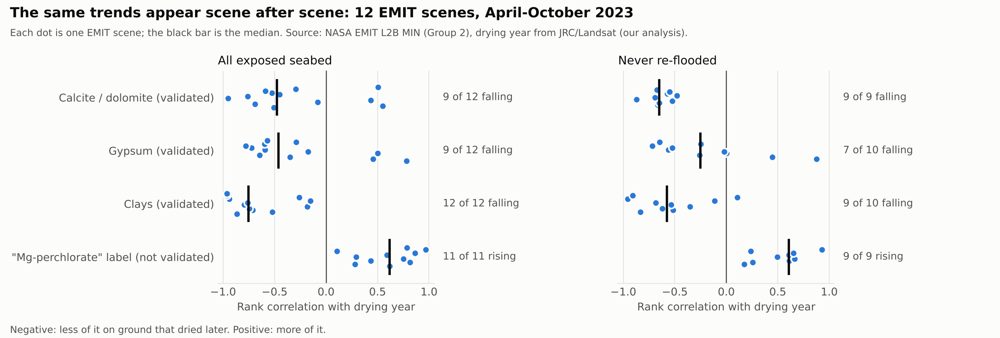
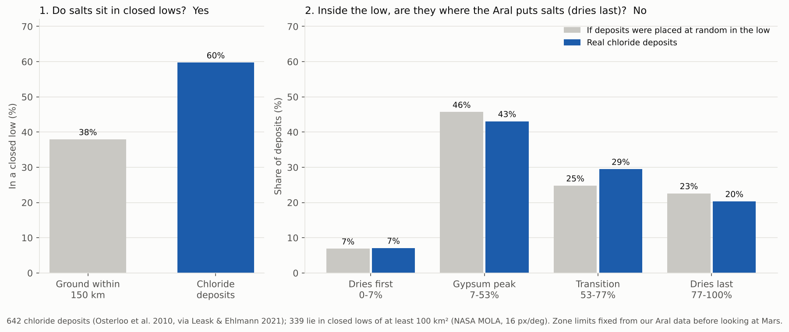
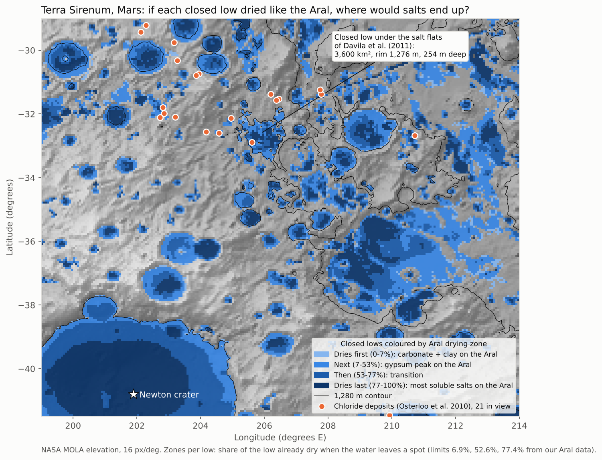
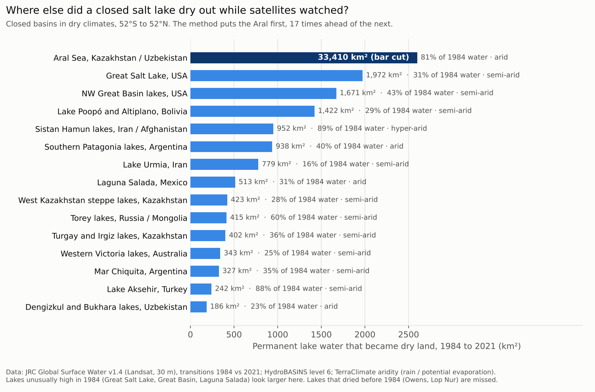
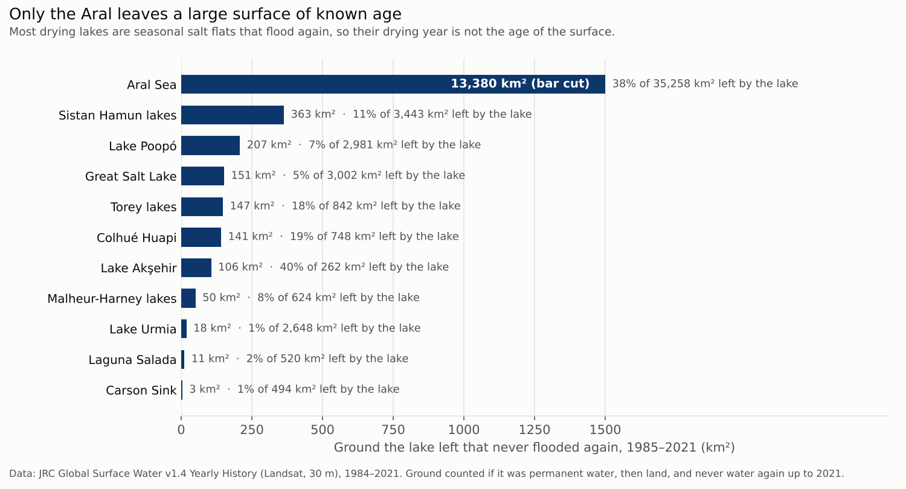
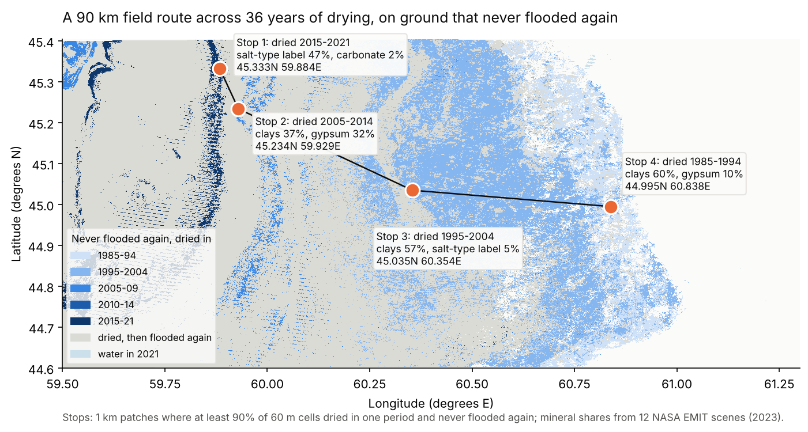

# A sea that became a Martian lakebed

**Two Earth analogs in Central Asia for Mars exploration: the Aralkum (Kazakhstan and Uzbekistan) and the Zhamanshin impact structure (Kazakhstan)**

NASA Space Apps Challenge 2026 · Challenge: *Identify Earth Locations that Analog the Permanent Moon Base Locations and Mars* · Team Koerziv (Universal Event)

**Live map:** https://noble-maxim-504110-d7.projects.earthengine.app/view/aralkum-analog

## In 30 seconds

- **A dated seabed.** We dated 34,964 km² of the dried Aral seabed pixel by pixel, 1985–2021, from NASA/USGS Landsat water history.
- **Minerals follow the date.** NASA EMIT sees carbonate and clay where the sea left first, gypsum in the middle and salts last, in 12 of 12 scenes. Two of the three trends match published field work.
- **Tested on Mars.** 642 Martian salt deposits sit in closed lows (60% vs 38% of the ground nearby), but not in the last-to-dry part where the Aral puts salts (20% vs 23% by chance). Most Martian salts probably formed in small ponds, not in one big drying lake.
- **A global search.** Of all lakes that dried in dry climates since 1984, the Aral ranks first. It is also the only one that leaves a large surface of known age: 13,380 km² that never flooded again, 37 times more than the next lake.
- **What it is for.** A 90 km field route for testing instruments, a map of salty-dust source ground, and a quick elevation test for Martian salt deposits.

## Summary

Mars had lakes that dried up and left salts behind. The Aral Sea is doing the same thing now, and satellites have recorded it every year since 1984. We dated when each 30 m piece of the Aral seabed dried out, then asked whether the surface minerals change with that date.

They do, and the result holds in two independent instruments. In 12 separate scenes from NASA's EMIT spectrometer, carbonate and clay are most common on ground the sea left first, gypsum peaks in the middle, and salt-type labels dominate the ground it left last. Landsat 8/9 shows a matching trend over the whole basin in three different summers. The two places that break the pattern are explained by documented flood pulses in 2010 and 2017.

Then we turned the Aral into a rule and tested it on Mars. If a basin dries like the Aral, its most soluble salts should end up in the last 23% of the lake area to dry. We checked 642 mapped Martian chloride deposits against NASA MOLA elevation data. They do collect in closed lows (60% of deposits vs 38% of the ground around them), but inside the lows they are not where the Aral puts salts (20% vs 23% by chance). So most Martian salts probably did not form the Aral way, in one big drying lake, which agrees with a recent study that explains them with small ponds.

Finally, we turned the method into a global search. Ranking every dry-climate basin between 52°S and 52°N by how much permanent lake water became land since 1984 puts the Aral first, 17 times ahead of the next region, and produces a list of other candidates. The Sistan lakes on the Iran–Afghanistan border stand out: hyper-arid, 89% dried, and not yet studied as a Mars analog as far as we found. A second test shows why the Aral is special: it left 13,400 km² of ground that never flooded again, 37 times more than any other drying lake we checked. Most others are salt flats that flood every year, so their surfaces cannot be dated.

We also tested whether free 30 m elevation data can see the rim of the Zhamanshin impact structure.

## What we found

### 1. A year-by-year map of the drying seabed

| Measure | Value |
|---|---|
| Basin below the 1960 sea level (53.4 m) | 68,206 km² |
| Seabed left by the permanent lake, 1985–2021 | 34,964 km² |
| Of that, flooded again in at least one later year | 21,052 km² (60%) |
| In the basin but never water, 1984–2021 | 15,415 km² |
| Still water in 2021 | 7,793 km² |

Two independent checks support the method. The basin outline from elevation data alone (68,206 km²) is close to the documented pre-1960 sea area of about 68,000 km². Our 2021 water area (7,793 km²) is close to the roughly 8,000 km² reported to remain. A data-quality check flagged six years with poor Landsat coverage (1984, 1985, 1988, 1990, 1995, 1997).

60% of the newly exposed seabed was under water again in a later year. The eastern basin behaves like a playa: it dries, floods and dries again.

### 2. Surface minerals follow the drying date: 12 EMIT scenes

We matched about 11 million EMIT pixels (60 m, Group 2 minerals) from 12 scenes taken between April and October 2023 to the drying-year map. Each scene was tested on its own: does the share of each mineral rise or fall with drying year (Spearman rank correlation)?

| Ground that dried in | Calcite/dolomite | Gypsum | Clays | "Mg-perchlorate" label |
|---|---|---|---|---|
| 1985–94 | 5.5% | 1.0% | 67% | 1.1% |
| 1995–2004 | 0.7% | **2.6%** | 46% | 1.8% |
| 2005–14 | 0.1% | 0.6% | 10% | 4.0% |
| 2015–21 | 0.0% | 0.0% | 1.3% | **34%** |

Median of the 12 scenes; each scene weighted by pixel count within its drying years.

| Mineral (NASA-validated unless noted) | All exposed seabed | Seabed that never re-flooded |
|---|---|---|
| Clays | fall in **12 of 12** scenes | fall in 9 of 10 |
| Calcite/dolomite | fall in 9 of 12 | fall in **9 of 9** |
| Gypsum | highest in a middle period in 6 of 7 scenes that cover all four periods | |
| "Mg-perchlorate" label (not validated) | rises in **11 of 11** | rises in **9 of 9** |

Using band depth instead of pixel counts gives the same directions.

Our interpretation: when salty water evaporates, the least soluble minerals come out first (carbonates), then gypsum, then the most soluble salts. The Aral grew saltier as it shrank, so ground exposed early was left by fresher water and ground exposed late by concentrated brine. Xi et al. (2025) describe the same order in Aral sediments. The clay trend runs against the simple expectation that finer, clay-rich sediment collects toward the center; one possible reason is that salt crusts on young ground hide the clay signal. That is a hypothesis we did not test.

**Ground truth from published field work.** We took no samples, so we compared our orbital trends with what others found on the ground:

| Our result from orbit | Published field and lab results | Agree? |
|---|---|---|
| Carbonate falls from old to young ground | Carbonates decrease from the older coastline towards the newly exposed seabed (Jiang et al. 2021, as summarized by Xi et al. 2025) | Yes |
| Salt-type label rises from old to young ground | Evaporite minerals increase towards the new seabed (Jiang et al. 2021). Seabed that dried in the 1960s–70s has low salinity, while seabed from the 1980s–90s turned into salt deserts (Singer et al.) | Yes |
| Clays fall from old to young ground | Clays *increase* towards the new seabed (Jiang et al. 2021). But clay-crusted takyr soils dominate the outer, older rim, and young solonchak soils are covered by salt crusts (Argaman et al. 2006) | No, which supports the idea that salt crusts hide clay from orbit |
| What the unvalidated "Mg-perchlorate" label may really be | Aral salt crusts contain halite plus sodium and magnesium sulfates such as thenardite and epsomite, together with gypsum (surface-crust study of the southern Aral basin) | Hydrated Mg sulfates are a plausible match; a hypothesis |

So two of our three mineral trends agree with field work. The third disagrees in a way that points to a known pitfall of orbital spectroscopy, on Mars as well as on Earth: thin salt crusts can hide what lies beneath.

### 3. A second instrument agrees: Landsat 8/9, whole basin, three summers

To check that the EMIT result does not depend on particular scenes, we used Landsat 8/9 summer composites (June–September) for 2022, 2023 and 2024 over the whole basin, averaged three indices for each drying year, and measured the rank correlation with drying year over the 32 drying-year zones larger than 100 km² (99.9% of the area).

| Summer | SWIR1/SWIR2 ratio | Brightness (SI) | Plant cover (NDVI) |
|---|---|---|---|
| 2022 | +0.81 | +0.24 | −0.24 |
| 2023 | +0.73 | +0.09 | −0.32 |
| 2024 | +0.79 | +0.11 | −0.19 |

The three summers agree with each other almost perfectly (rank correlation 0.98 between years). The SWIR ratio, which responds to clays, carbonates, gypsum and moisture near 2.2 µm, rises with later drying. Brightness does not follow drying date, and plant cover follows it only weakly.

**Check on ground that never re-flooded.** We expected the trend to get stronger here. It did not: the SWIR ratio still rises with drying year (+0.74, +0.71, +0.71), slightly weaker than on all ground over the same years (+0.82, +0.75, +0.79). Plant cover falls more clearly with drying year on this ground (−0.45 to −0.58), so older surfaces are greener, and vegetation is a real confounder for the Landsat indices.

### 4. The exceptions are documented flood pulses

Two large zones break the Landsat trend: ground the map dates to **2011 (1,807 km²)** and **2018 (1,754 km²)**. Their SWIR ratio is about 1.22, like ground from the 1980s.

- **2011 zone.** [Team observation: describe what the zoomed satellite view shows here, in your own words.] The record explains it: 2010 was the highest flow year on the Amu Darya since 1998, and the eastern basin grew from 857 to 5,211 km² between November 2009 and November 2010, before flow fell sharply in 2011 (Micklin). Our map dates that ground to 2011 because 2010 was its last year of permanent water.
- **2018 zone.** [Team observation.] In 2017 heavy outflow from the North Aral partially refilled the eastern lobe (NASA Earth Observatory).

So for these zones, "drying year" marks the end of a short flood, not the slow retreat of the old sea. The 2010 flood water was much fresher (salinity perhaps as low as 20 g/l), which may explain why that ground looks like the oldest seabed. That last link is our inference.

Both dips remain on ground that never re-flooded (2011: SWIR ratio 1.14 vs 1.41 in the neighbouring years; 2018: 1.18 vs 1.50). This is expected: for these zones the flood pulse itself was the last year of permanent water, so the re-flood filter cannot remove them. The flood-pulse explanation therefore rests on the river and lake records, not on this filter.

### 5. Zhamanshin: what 30 m data can and cannot see

Two sizes are published for this impact structure: about 13.5 km (Garvin & Schnetzler 1992) and about 26.5 km with multiple rings (Garvin et al. 2026, from 2 m elevation data). We removed the regional tilt from NASADEM and Copernicus DEM and averaged elevation in rings around the center.

- Both elevation models give almost the same profile.
- The center is a high of roughly +75 m, not a bowl; the profile falls to near zero by about 20 km.
- The four sectors (N, E, S, W) differ strongly.
- We see no clear ring at 13.25 km radius in 30 m data.

So the larger size cannot be confirmed with free 30 m data. Subtle impact structures can be missed at this resolution, which also matters for Mars and the Moon.

### 6. Mars test: does the Aral drying order predict where Martian salts are?

The Aral gives a rule that can be tested: in a closed basin that dries by evaporation, the most soluble salts end up in the **last 22.6% of the lake area to dry**. We fixed that number from our Aral data before looking at any Mars data. Then we tested it on the 642 chloride (salt) deposits that Osterloo et al. (2010) mapped with THEMIS on NASA's Mars Odyssey (point list published by Leask & Ehlmann, CC0).

**Method.** We read NASA's MOLA global elevation grid (16 pixels per degree, about 3.7 km) and filled every closed low between 70°S and 20°N, the way water poured in would fill it up to its lowest rim point. For each deposit inside a closed low we computed the share of that low that would already be dry when a falling water level leaves the deposit. If deposits were scattered at random inside the lows, that share would be spread evenly between 0 and 1, and 22.6% of deposits would land in the last band. We checked the code on 600 random points: 23% landed there, as expected.

| Test | Result |
|---|---|
| Do deposits sit in closed lows more often than the ground around them? | **Yes.** 60% of deposits vs 38% of the ground within 150 km of them (z = 12). The same holds region by region: in 214 of 333 two-degree cells the deposits sit in lows more often than the ground around them, in 119 less often (sign test p = 2×10⁻⁷). |
| Inside lows of at least 100 km², are deposits in the Aral's last-to-dry band? | **No.** 20% of 339 deposits vs 22.6% by chance (p = 0.88). Counting one value per low: 36 of 160 lows vs 28.7 by chance (p = 0.08, not significant). |

So **the Aral rule fails on Mars at the scale MOLA can see.** Martian salts do collect in closed lows, as Osterloo et al. (2010) reported, but not in the part of the low that would dry last. Splitting by size, which we decided only after the main test: in lows of 100–10,000 km² the share in the last band is a little above chance (26–30%, not significant). In lows larger than 10,000 km² it is well below chance (11% of 161 deposits), but those deposits sit in only 34 lows, and counted per low the shortfall is not significant (p = 0.13).

This matches what Leask & Ehlmann (2022) saw in high-resolution images. The deposits do not fill basins the way the salt flats of Death Valley do. They sit in shallow depressions, sometimes perched above much larger craters that have no salt at all. They explain the salts with small ponds fed by runoff from melting ice. The Aral is one big lake drying out, and our test suggests most Martian chlorides did not form that way.

**Terra Sirenum close-up.** The salt flats described by Davila et al. (2011) sit in a closed low at 31.8–33.5°S, 205.1–206.6°E, about 520 km north-north-east of Newton crater's centre. MOLA puts its rim at 1,276 m, essentially their 1,280 m contour, and its floor at 1,022 m, so its depth of 254 m matches their "at least 200 m". The area does not match: the closed low covers about 3,600 km², a tenth of their 30,000 km² or more, and we could not find the reason. A larger closed low (32,700 km², 34.6–38.6°S) lies farther south but holds no mapped chloride deposits. Many deposits in the north-west of the map lie on higher ground, outside any closed low.

### 7. A global search: where else did a closed salt lake dry out while satellites watched?

The Aral is useful because a large closed lake dried during the satellite era and left ground of known age. The challenge asks for systematic ways to find new analogs, so we searched the whole Earth between 52°S and 52°N (the latitudes NASA EMIT observes) for the same process.

**Method** (`step4_global_drying_lakes.js`, `finder_rank.py`). For every river basin in HydroBASINS (level 6) we measured how much of the 1984 permanent water had become land by 2021 (JRC Global Surface Water transitions, 30 m). We also recorded whether the basin drains to the sea and how dry its climate is (TerraClimate rain divided by potential evaporation, 1991–2020). We kept basins with a dryness index below 0.5, joined neighbouring basins into lake regions, and named the regions from their coordinates. Reservoirs, river floodplains and deltas were left out.

**The search finds the Aral first.** 33,400 km² of its permanent water became land, 17 times more than in the next region and within 5% of our own drying map (35,000 km²). This checks that the search works. The next regions are lakes known to be shrinking: Great Salt Lake, the closed lakes of the north-western Great Basin, Lake Poopó in Bolivia, the Sistan Hamun lakes on the Iran–Afghanistan border, and Lake Urmia in Iran.

What it adds:
- **A ranked list of candidates for the same Mars-analog use.** The Sistan lakes stand out. They lie in a hyper-arid climate (dryness index 0.03), have lost 89% of their 1984 water, and are a major dust source. Of the top ten, only Great Salt Lake is an established Mars analog in the literature we checked; we found no Mars-analog studies of Lake Poopó or Lake Urmia.
- **A local angle.** Three of the top eleven regions are in Kazakhstan: the Aral, the steppe lakes of West Kazakhstan, and the Turgay and Irgiz lakes near Zhamanshin crater.
- **A test of which lakes can be dated** (`step6_datable_ground.js`). The mineral test needs ground that stayed dry after the lake left, so that drying year is the age of the surface. We tried to repeat it on Lake Urmia and found that 99% of the ground its permanent lake left was flooded again later: Urmia is a salt flat that floods every spring. We then measured this for the top lakes in one run.

The Aral left 13,400 km² of ground that never flooded again, 38% of what its lake gave up. That is 37 times more than the next lake (Sistan, 363 km²) and 11 times more than the other ten lakes together. Most drying lakes are seasonal salt flats, so the Aral is unusual: it is the one large basin where satellites can date the surface year by year. This is why we could not repeat the mineral test elsewhere in the time we had. Lake Akşehir (Turkey) keeps a similar share dry (40%), but over only 106 km².

Limits: the search compares only 1984 and 2021. Lakes that were unusually high in 1984 look larger: Great Salt Lake reached record levels in the mid-1980s. Lakes that dried before 1984, such as Owens Lake and Lop Nur, are missed. Names were assigned by hand from coordinates.

### 8. A field route for testing instruments, and a map of dust-source ground

**A 90 km route across 36 years of drying** (`field_route.py`). If the Aral is to serve as a test site for orbital or rover instruments on an evaporite sequence of known age, people need places to go. We picked four stops. Each is a 1 km patch where at least 90% of the 60 m cells dried in one period and never flooded again, and stops were chained so each lies within 40 km of the previous one.

| Stop | Dried | Latitude, longitude | What 12 EMIT scenes see most (share of pixels) |
|---|---|---|---|
| 1 | 2015–2021 | 45.333 N, 59.884 E | salt-type label 47% |
| 2 | 2005–2014 | 45.234 N, 59.929 E | clays 37%, gypsum 32% |
| 3 | 1995–2004 | 45.035 N, 60.354 E | clays 57%, salt-type label 5% |
| 4 | 1985–1994 | 44.995 N, 60.838 E | clays 60%, gypsum 10%, carbonate 4% |

Walking or driving from stop 1 to stop 4 crosses the evaporite sequence backwards in time: salts, then gypsum, then clay and carbonate. A team could check orbital mineral maps against samples at each stop, test whether an instrument can tell the stages apart, or practise rover traverses on salt crust and on fine dusty ground. The coordinates come from orbital data only; nobody has visited these stops for this project.

**A map of dust-source ground.** The Aralkum is one of the most active dust sources in Central Asia, and its north-eastern part is among the most active areas (Indoitu et al. 2015). Field studies describe two kinds of source ground. Clay-crusted takyr soils on the older outer rim erode easily, while young salt-crusted soils resist wind better (Argaman et al. 2006). Dust collected near the Aralkum carries much more sulfate and chloride than dust from sandy deserts (Groll et al. 2019). Our map separates these grounds: 15,415 km² inside the basin dried before 1984 (the outer rim), and 34,964 km² is dated year by year since then, including 5,759 km² that dried in 2015–2021. That could help dust modellers, and the people planting shrubs to fix the seabed, decide where to work. Martian dust also carries salts, so the same ground is a natural test site for salty-dust instruments.

## What this means for Mars

| Mars site | Where the Aral analogy works | Where it breaks |
|---|---|---|
| **Chloride deposits** across the southern highlands (642 mapped) | Salts collect in closed lows in both places (our test 1). | Inside the lows, Martian salts are not where the Aral puts them (our test 2). Most seem to come from small ponds, not one big drying lake. |
| **Terra Sirenum** basin proposed as a large lake (Davila et al. 2011) | If it was one big lake, the Aral is the right kind of analog, and our zone map says where each mineral would sit. | MOLA confirms the rim and depth of the low under the salt flats but not the 30,000 km² size. Martian chlorides almost never come with carbonates or sulfates; the Aral shows all three. |
| **Jezero crater** carbonates along the old shoreline | Carbonate near the shore and salts in the centre is what a slowly evaporating lake leaves. | It is not proven that Jezero's carbonates formed in the lake. |
| **Gale crater** mud cracks from repeated wetting and drying | The Aral shows from orbit a lakebed that floods and dries again and again. | We measure yearly flooding at 30 m, not centimetre-scale cracks. |

**What we learned:** the Aral is a good analog for one kind of Martian environment, a large lake drying out, and a place to test how orbital instruments see such a basin. It is not a template for most Martian chloride deposits. A simple rule from the Aral, tested on 642 deposits, tells the two apart: big-lake salts should sit in the last-to-dry part of their basin, and most Martian salts do not.

**How this helps exploration:** it shows where in a dried basin to look for each mineral if the basin was a big lake, and gives a quick test, using elevation data alone, of whether a Martian salt deposit fits the big-lake picture. The Aral is also a living example of wet-dry cycling for testing orbital methods, and a warning that automatic mineral labels from orbit can mislead.

## Limits

- **Unvalidated labels.** About 58% of EMIT pixels carry labels outside NASA's 10 validated minerals (for example "Mg-perchlorate", prehnite, portlandite). We do not claim perchlorate exists on the Aral seabed; the label more likely marks a salt crust with a similar spectrum. Its amount is also unstable: 0% of the seabed in some scenes, up to 37% in others. Only its direction is consistent.
- **Scenes are not fully independent.** They show the same surface in the same year, so "12 of 12" overstates the certainty somewhat.
- **The never-re-flooded filter was chosen after** we saw the 2011 and 2018 zones in the Landsat data, though before running it on EMIT.
- **Moisture.** The Landsat SWIR ratio also rises with damp ground, so it supports the EMIT trend but cannot separate hydrated salts from wetness.
- **Halite is invisible** to EMIT at these wavelengths, on Earth and on Mars.
- **Correlation, not proof.** Zones also differ in grain size, plant cover and wind erosion. Wind may have stripped salt from older surfaces.
- **No ground samples.** Everything is from orbit.
- **Landsat gaps.** Early retreat years are less certain, and ground that dried before 1984 is barely covered by our EMIT scenes.
- **Today's Mars is not ancient Mars.** MOLA shows the surface after billions of years of later craters, faults and erosion, so today's lows are not always the lows the water saw. A deposit perched above a younger crater counts against the Aral rule in our test even if it formed at the bottom of an older pond.
- **Resolution.** At 3.7 km per pixel, MOLA misses small lows and channels, and most deposits (1–25 km²) are smaller than a few pixels. Deposits are single points, not outlines. Our drying model assumes one water level falling evenly through each low.
- **Clustered deposits.** Deposits come in groups, so we also tested one value per low and per two-degree cell; the per-low numbers are the more cautious ones.
- **Earth is not Mars.** The Aral dried in about 60 years because of irrigation; Martian lakes dried over far longer, about 3.5 billion years ago. Aral sediment holds fertilizer and pesticide residues, has plants and gets rain. Gravity, atmosphere and radiation differ.

## Data

**NASA**
- EMIT L2B Estimated Mineral Identification and Band Depth, 60 m, V001 (via AppEEARS), 12 scenes from 2023. https://doi.org/10.5067/EMIT/EMITL2BMIN.001
- Landsat 5/7/8 (basis of the water history) and Landsat 8/9 Collection 2 Level 2 surface reflectance (NASA/USGS)
- NASADEM 30 m elevation
- Mars Orbiter Laser Altimeter (MOLA) Mission Experiment Gridded Data Record, 16 pixels/degree topography (MGS-M-MOLA-5-MEGDR-L3-V1.0, file megt90n000eb), NASA Planetary Data System Geosciences Node
- Chloride deposits mapped from Mars Odyssey THEMIS data (Osterloo et al. 2010), as the point list with geologic units published by Leask & Ehlmann (2021), CaltechDATA, CC0, https://doi.org/10.22002/D1.2176

**Partners and other open data**
- JRC Global Surface Water v1.4, Yearly History. Pekel et al. 2016, Nature 540, 418–422. Source: EC JRC/Google
- Copernicus GLO-30 DEM (ESA)
- HydroSHEDS / HydroBASINS level 6 river basins (WWF; Lehner & Grill 2013)
- TerraClimate monthly climate, precipitation and reference evapotranspiration 1991–2020 (Abatzoglou et al. 2018)

**Tools:** Google Earth Engine, NASA AppEEARS, Python (numpy, pandas, scipy, scikit-image, matplotlib, tifffile).

## Files

| File | What it is |
|---|---|
| `step1_lake_retreat.js` | Earth Engine: drying-year and re-flood maps, areas, data-quality check |
| `step2_zhamanshin.js` | Earth Engine: radial elevation profiles of Zhamanshin |
| `step3_salt_index.js` | Earth Engine: Landsat 8/9 indices against drying year, three summers |
| `step4_global_drying_lakes.js` | Earth Engine: global search for drying lakes in dry climates |
| `finder_rank.py`, `global_drying_lakes.csv`, `finder_top_lakes.csv` | Python and tables: groups basins into lake regions and ranks them |
| `step5_second_lake.js` | Earth Engine: drying-year map for a second lake (Lake Urmia) |
| `step6_datable_ground.js`, `datable_ground.csv`, `datable_chart.py` | Earth Engine, table and chart: how much ground each top lake left that never flooded again |
| `field_route.py`, `field_route.csv`, `field_route.png` | Python: the four-stop field route with EMIT mineral shares |
| `slide_charts.py`, `drying_map.png` | Python: slide-sized charts, including the drying map at the top of this page |
| `app.js` | Earth Engine: the public map app |
| `emit_io.py` | Python: readers for AppEEARS ENVI files and the Earth Engine GeoTIFF |
| `emit_vs_retreat.py`, `plot_zones.py` | Python: first 4-scene analysis and chart |
| `emit_trends.py`, `plot_trends.py` | Python: 12-scene trend test and charts |
| `aralkum_emit_area.geojson` | Area of the EMIT request (59.5–61.3°E, 44.6–45.4°N) |
| `emit_trend_summary.csv`, `emit_trend_per_scene.csv`, `emit_share_per_scene_year.csv` | 12-scene results |
| `landsat_indices_with_area.csv` | Landsat indices per drying year and summer, with zone areas |
| `*_by_zone.csv`, `pooled_*.csv`, `family_share_by_scene.csv` | First 4-scene results |
| `aral_*.csv`, `zhamanshin_*.csv` | Tables exported from Earth Engine |
| `step3b_salt_index_noreflood.js`, `aral_landsat_indices_noreflood.csv` | Earth Engine: the Landsat test on never-re-flooded ground, and its output |
| `mars_basin.py` | Python: MOLA reader; first test of whether the 1,280 m contour closes |
| `mars_depressions.py` | Python: closed lows around Newton crater (priority-flood), basin size, depth and distance |
| `mars_fill_global.py` | Python: fills every closed low on Mars from 70°S to 20°N |
| `mars_chloride_test.py` | Python: the two tests on 642 chloride deposits |
| `make_random_points.py` | Python: random points used to check that the test gives 22.6% when there is no effect |
| `mars_figures.py` | Python: Terra Sirenum map and the chloride test chart |
| `mars_chloride_F.csv`, `mars_chloride_test.json` | Per-deposit results and test statistics |
| `mars_depressions.json` | Closed lows near Newton crater larger than 3,000 km² |

To reproduce: run the Earth Engine scripts, request EMITL2BMIN Group 2 layers in AppEEARS for the GeoJSON area (1 Apr–31 Oct 2023, ENVI format), then run `emit_trends.py <folder with files>` and `plot_trends.py`.

## Use of AI

We used Claude (Anthropic AI assistant) as a tool, and state where:

- **Before the hackathon:** comparing challenges and suggesting candidate sites and the research question, which the team then evaluated.
- **Code:** Claude assisted in drafting the code; the team ran it, checked the outputs and reported errors that were then fixed. Each file says so in its header.
- **Analysis:** Claude ran the EMIT and Landsat statistics on files the team exported and downloaded, and made the charts (computed from data, not AI-generated imagery). Claude proposed the second-instrument check, the per-scene trend test and the never-re-flooded filter.
- **Research:** finding and summarizing papers and datasets, including the flood records that explain the 2011 and 2018 zones, the MOLA grid and the chloride deposit list.
- **Mars test:** Claude proposed turning the Aral zones into a rule and testing it on Martian chloride deposits, wrote the code, and ran it on the files the team downloaded.
- **Global search:** Claude proposed the global drying-lake search and the drying-date check (Lake Urmia, step 6), wrote the code and ranked the results; the team ran the Earth Engine exports.
- **Text:** the interpretation, the Mars comparison and this report were drafted with Claude and reviewed by the team.
- **Team's own observations:** [list what you did yourself, e.g. inspecting the 2011 and 2018 zones on satellite images].

No AI-generated images, video or audio are used.

## References

- Xi, X. et al. (2025). Analysis of a saline dust storm from the Aralkum Desert, Part 1. *Atmos. Chem. Phys.* 25, 7403. (Also summarizes Jiang et al. 2021 on mineral gradients across the seabed.)
- Pekel, J.-F. et al. (2016). High-resolution mapping of global surface water and its long-term changes. *Nature* 540, 418–422.
- Green, R. (2023). EMIT L2B Estimated Mineral Identification and Band Depth and Uncertainty 60 m V001. NASA LP DAAC.
- Micklin, P. (2014). Chapter 15 in *The Aral Sea*, Springer Earth System Sciences. https://doi.org/10.1007/978-3-642-02356-9_15
- NASA Earth Observatory (2017). New Water in the Aral Sea. https://earthobservatory.nasa.gov/images/90857/new-water-in-the-aral-sea
- Garvin, J. B. & Schnetzler, C. C. (1992). The Zhamanshin impact feature: a new class of complex crater? https://ntrs.nasa.gov/citations/19930000951
- Garvin, J. B. et al. (2026). The Zhamanshin Impact Event. arXiv:2604.04884.
- Osterloo, M. M. et al. (2008). Chloride-bearing materials in the southern highlands of Mars. *Science* 319.
- Glotch, T. D. et al. (2010). Distribution and formation of chlorides and phyllosilicates in Terra Sirenum, Mars. *Geophys. Res. Lett.* 37, L16202.
- Davila, A. F. et al. (2011). A large sedimentary basin in the Terra Sirenum region of the southern highlands of Mars. *Icarus* 212, 579–589.
- Hynek, B. M. et al. (2015). Late-stage formation of Martian chloride salts through ponding and evaporation. *Geology*.
- Horgan, B. H. N. et al. (2020). The mineral diversity of Jezero crater. *Icarus* 339, 113526.
- Rapin, W. et al. (2023). Sustained wet–dry cycling on early Mars. *Nature*.
- Leask, E. K. & Ehlmann, B. L. (2022). Evidence for deposition of chloride on Mars from small-volume surface water events into the Late Hesperian–Early Amazonian. *AGU Advances* 3, e2021AV000534. Data: https://doi.org/10.22002/D1.2176
- Osterloo, M. M. et al. (2010). Geologic context of proposed chloride-bearing materials on Mars. *J. Geophys. Res.* 115, E10012.
- Smith, D. E. et al. (2003). Mars Global Surveyor Laser Altimeter Mission Experiment Gridded Data Record, MGS-M-MOLA-5-MEGDR-L3-V1.0. NASA Planetary Data System.
- Yao, F. et al. (2023). Satellites reveal widespread decline in global lake water storage. *Science* 380, 743–749.
- Lehner, B. & Grill, G. (2013). Global river hydrography and network routing: baseline data and new approaches to study the world's large river systems. *Hydrological Processes* 27, 2171–2186.
- Abatzoglou, J. T. et al. (2018). TerraClimate, a high-resolution global dataset of monthly climate and climatic water balance from 1958–2015. *Scientific Data* 5, 170191.
- Argaman, E., Singer, A. & Tsoar, H. (2006). Erodibility of some crust forming soils/sediments from the Southern Aral Sea Basin as determined in a wind tunnel. *Earth Surface Processes and Landforms* 31, 47–63.
- Groll, M. et al. (2019). Physical and chemical characterization of dust deposited in the Turan Lowland (Central Asia). *E3S Web of Conferences* 99, 03005.
- Indoitu, R. et al. (2015). Dust emission and environmental changes in the dried bottom of the Aral Sea. *Aeolian Research* 17, 101–115.
- Singer, A. et al. Aral Sea. *Mitteilungen der IAG BOKU* 13, 99–116. https://opac.geologie.ac.at/ais312/dokumente/Mitt_IAG_Boku_13_099_116_SINGER_ET_AL.pdf
- Surface crusts on soils/sediments of the southern Aral Sea basin, Uzbekistan. https://www.researchgate.net/publication/223680211
- AppEEARS Team (2026). AppEEARS v3.137. NASA EOSDIS LP DAAC.
