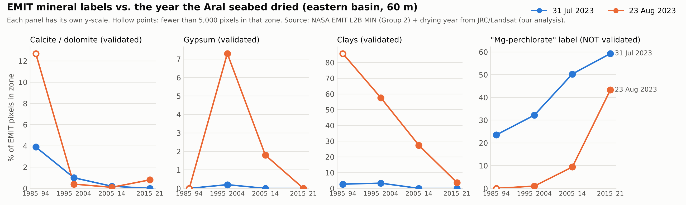

# A sea that became a Martian lakebed

**Aralkum and Zhamanshin: two Earth analogs in Kazakhstan for Mars exploration**

NASA Space Apps Challenge 2026 · Challenge: *Identify Earth Locations that Analog the Permanent Moon Base Locations and Mars* · Team Koerziv (Universal Event)

**Live map:** https://noble-maxim-504110-d7.projects.earthengine.app/view/aralkum-analog

## Summary

Mars had lakes that dried up and left salts behind. The Aral Sea is doing the same thing now, and satellites have recorded it year by year since 1984. We dated when each 30 m piece of the Aral seabed dried out, then checked whether the minerals NASA's EMIT instrument sees on the surface change with that date. They do: carbonate labels are most common on ground that dried first, and salt-type labels on ground that dried last. We also tested whether free 30 m elevation data can see the rim of the Zhamanshin impact structure.

## What we found

### 1. A year-by-year map of the drying seabed

| Measure | Value |
|---|---|
| Basin below the 1960 sea level (53.4 m) | 68,206 km² |
| Seabed left by the permanent lake, 1985–2021 | 34,964 km² |
| Of that, flooded again in at least one later year | 21,052 km² (60%) |
| In the basin but never water, 1984–2021 | 15,415 km² |
| Still water in 2021 | 7,793 km² |

Two independent checks support the method. The basin outline from elevation data alone (68,206 km²) is close to the documented pre-1960 sea area of about 68,000 km². Our 2021 water area (7,793 km²) is close to the roughly 8,000 km² reported to remain.

60% of the newly exposed seabed was under water again in a later year. The eastern basin behaves like a playa: it dries, floods and dries again.

### 2. Surface minerals follow the drying date

We matched about 5 million EMIT pixels (60 m) from four 2023 scenes to the drying-year map.

| Ground that dried in | Calcite/dolomite, 31 Jul | "Mg-perchlorate" label, 31 Jul | "Mg-perchlorate" label, 23 Aug |
|---|---|---|---|
| 1985–1994 | 3.9% | 23.5% | 0.0%* |
| 1995–2004 | 1.0% | 32.2% | 1.0% |
| 2005–2014 | 0.2% | 50.3% | 9.4% |
| 2015–2021 | 0.0% | 59.3% | 43.3% |

\* only 1,662 pixels in this zone on that date.

- **Seen on both dates:** carbonate falls with later drying, and the salt-type label rises.
- **Seen on one date only (weaker):** gypsum peaks in the 1995–2004 zone (7.3% on 23 Aug); clays fall from 86% to 4% on 23 Aug.

Our interpretation: when salty water evaporates, the least soluble minerals come out first (carbonates), then gypsum, then the most soluble salts. The Aral grew saltier as it shrank, so ground exposed early was left by fresher water and ground exposed late by concentrated brine. Xi et al. (2025) describe the same order in Aral sediments.

### 3. Zhamanshin: what 30 m data can and cannot see

Two sizes are published for this impact structure: about 13.5 km (Garvin & Schnetzler 1992) and about 26.5 km with multiple rings (Garvin et al. 2026, from 2 m elevation data). We removed the regional tilt from NASADEM and Copernicus DEM and averaged elevation in rings around the center.

- Both elevation models give almost the same profile.
- The center is a high of about +75 m, not a bowl; the profile falls to zero by about 20 km.
- The four sectors (N, E, S, W) differ strongly.
- We see no clear ring at 13.25 km radius in 30 m data.

So the larger size cannot be confirmed with a free 30 m data. Subtle impact structures can be missed at this resolution, which also matters for Mars and the Moon.

## What this means for Mars

| Mars site | Where the Aral analogy works | Where it breaks |
|---|---|---|
| **Terra Sirenum** chloride salt flats (10–50 km² at the lowest points of a 300–400 km basin) | The most soluble salts end up at the bottom of a closed basin in both places. | Martian chlorides almost never come with carbonates or sulfates; the Aral shows all three. |
| **Jezero crater** carbonates along the old shoreline | Carbonate near the shore and salts in the center is what a slowly evaporating lake leaves. | It is not proven that Jezero's carbonates formed in the lake. |
| **Gale crater** mud cracks from repeated wetting and drying | The Aral shows from orbit what a repeatedly flooded lakebed looks like while it is happening. | We measure yearly flooding at 30 m, not centimetre-scale cracks. |

**Hypothesis (not tested here):** on Mars, the carbonates and sulfates that models say should form before chlorides may lie higher on basin margins, not next to the chlorides.

**How this helps exploration:** it suggests where in a dried basin to look for each mineral, gives a living example of wet-dry cycling for testing orbital methods, and shows how automatic mineral labels from orbit can mislead.

## Limits

- **Unvalidated labels.** About 58% of EMIT pixels carry labels outside NASA's 10 validated minerals (for example "Mg-perchlorate", prehnite, portlandite). We do not claim perchlorate exists on the Aral seabed; the label more likely marks a salt crust with a similar spectrum.
- **Halite is invisible** to EMIT at these wavelengths, on Earth and on Mars.
- **The two main dates disagree in detail,** probably because of surface moisture or viewing conditions. Only trends seen on both dates are treated as results.
- **Correlation, not proof.** Zones also differ in grain size, plant cover and wind erosion. Wind may have stripped salt from older surfaces.
- **No ground samples.** Everything is from orbit.
- **Landsat gaps.** 1984, 1985, 1988, 1990, 1995 and 1997 have poor coverage, so early retreat years are less certain. Ground that dried before 1984 is barely covered by our EMIT scenes.
- **Earth is not Mars.** The Aral dried in about 60 years because of irrigation; Martian lakes dried over far longer, about 3.5 billion years ago. Aral sediment holds fertilizer and pesticide residues, has plants and gets rain. Gravity, atmosphere and radiation differ.

## Data

**NASA**
- EMIT L2B Estimated Mineral Identification and Band Depth, 60 m, V001 (via AppEEARS). https://doi.org/10.5067/EMIT/EMITL2BMIN.001
- NASADEM 30 m elevation
- Landsat 5/7/8 (basis of the water history below)

**Partners and other open data**
- JRC Global Surface Water v1.4, Yearly History. Pekel et al. 2016, Nature 540, 418–422. Source: EC JRC/Google
- Copernicus GLO-30 DEM (ESA)

**Tools:** Google Earth Engine, NASA AppEEARS, Python (numpy, pandas, matplotlib, tifffile).

## Files

| File | What it is |
|---|---|
| `step1_lake_retreat.js` | Earth Engine: drying-year and re-flood maps, areas, data-quality check |
| `step2_zhamanshin.js` | Earth Engine: radial elevation profiles of Zhamanshin |
| `app.js` | Earth Engine: the public map app |
| `emit_io.py`, `emit_vs_retreat.py`, `plot_zones.py` | Python: match EMIT pixels to drying year, make tables and the chart |
| `aralkum_emit_area.geojson` | Area of the EMIT request (59.5–61.3°E, 44.6–45.4°N) |
| `*_by_zone.csv`, `pooled_*.csv`, `family_share_by_scene.csv` | Mineral label shares by drying zone |
| `aral_*.csv`, `zhamanshin_*.csv` | Tables exported from Earth Engine |

To reproduce: run the Earth Engine scripts, request EMITL2BMIN Group 2 layers in AppEEARS for the GeoJSON area (1 Apr–31 Oct 2023, ENVI format), then run `emit_vs_retreat.py <folder with files>` and `plot_zones.py`.

## Use of AI

We used Claude (Anthropic AI assistant) as a tool, and state where:

- **Before the hackathon:** comparing challenges and suggesting candidate sites and the research question, which the team then evaluated.
- **Code:** Claude assisted in drafting the code; our team ran it, checked the outputs and reported errors that were then fixed. Each file says so in its header.
- **Analysis:** Claude ran the EMIT-vs-drying-year calculation on files the team downloaded, and made the chart (the chart is computed from data, not AI-generated imagery).
- **Research:** finding and summarizing papers and datasets.

No AI-generated images, video or audio are used.

## References

- Xi, X. et al. (2025). Analysis of a saline dust storm from the Aralkum Desert, Part 1. *Atmos. Chem. Phys.* 25, 7403. https://acp.copernicus.org/articles/25/7403/2025/acp-25-7403-2025.html
- Pekel, J.-F. et al. (2016). High-resolution mapping of global surface water and its long-term changes. *Nature* 540, 418–422.
- Green, R. (2023). EMIT L2B Estimated Mineral Identification and Band Depth and Uncertainty 60 m V001. NASA LP DAAC.
- Garvin, J. B. & Schnetzler, C. C. (1992). The Zhamanshin impact feature: a new class of complex crater? https://ntrs.nasa.gov/citations/19930000951
- Garvin, J. B. et al. (2026). The Zhamanshin Impact Event. arXiv:2604.04884.
- Osterloo, M. M. et al. (2008). Chloride-bearing materials in the southern highlands of Mars. *Science* 319.
- Glotch, T. D. et al. (2010). Distribution and formation of chlorides and phyllosilicates in Terra Sirenum, Mars. *Geophys. Res. Lett.* 37, L16202.
- Davila, A. et al. (2011). A large sedimentary basin in the Terra Sirenum region. *Icarus* 212, 579–589.
- Hynek, B. M. et al. (2015). Late-stage formation of Martian chloride salts through ponding and evaporation. *Geology*.
- Horgan, B. H. N. et al. (2020). The mineral diversity of Jezero crater. *Icarus* 339, 113526.
- Rapin, W. et al. (2023). Sustained wet–dry cycling on early Mars. *Nature*.
- AppEEARS Team (2026). AppEEARS v3.137. NASA EOSDIS LP DAAC.
